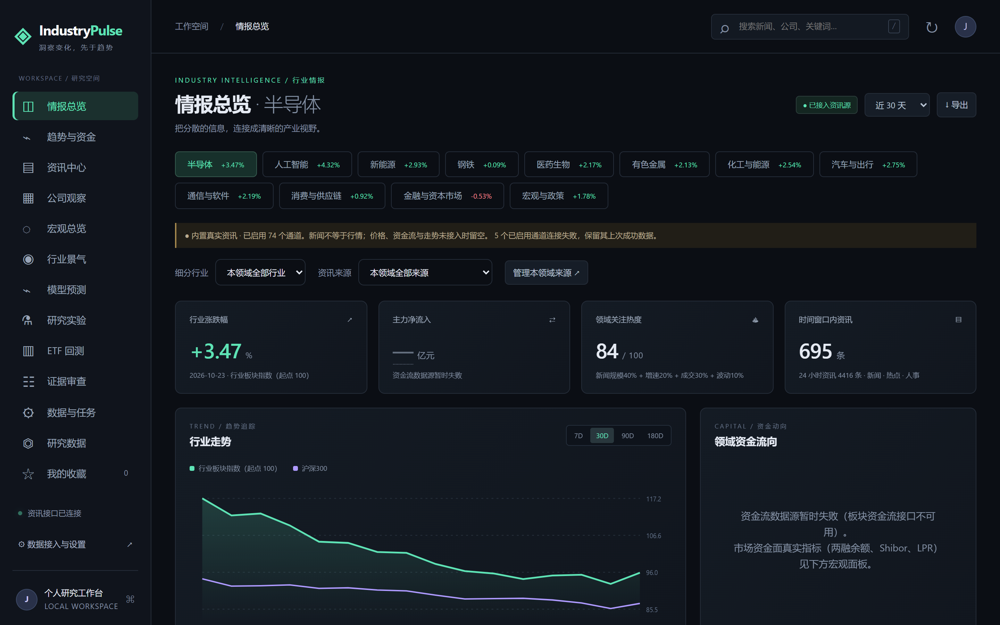
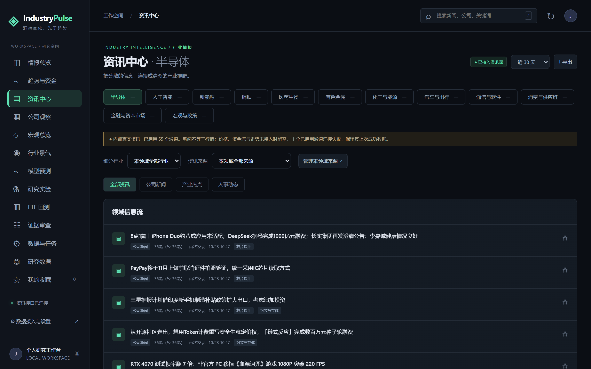
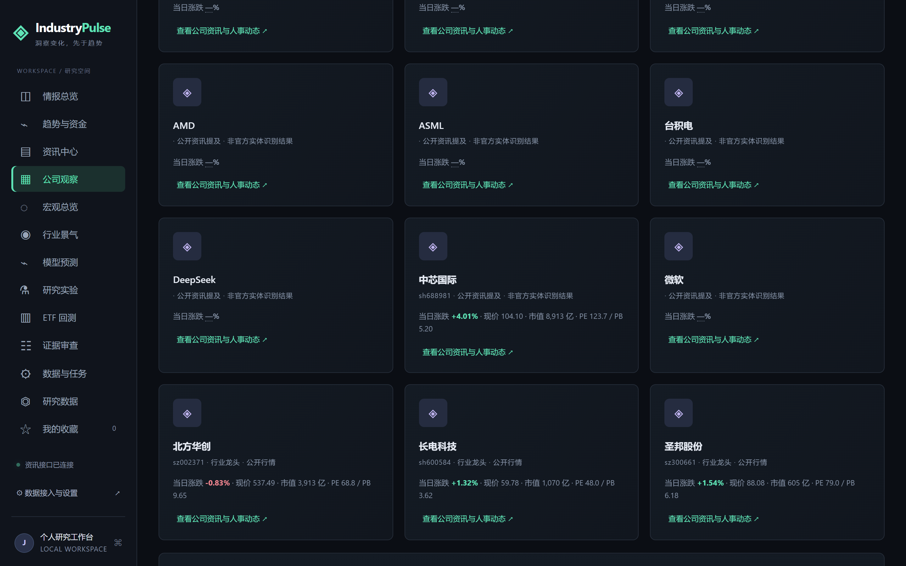
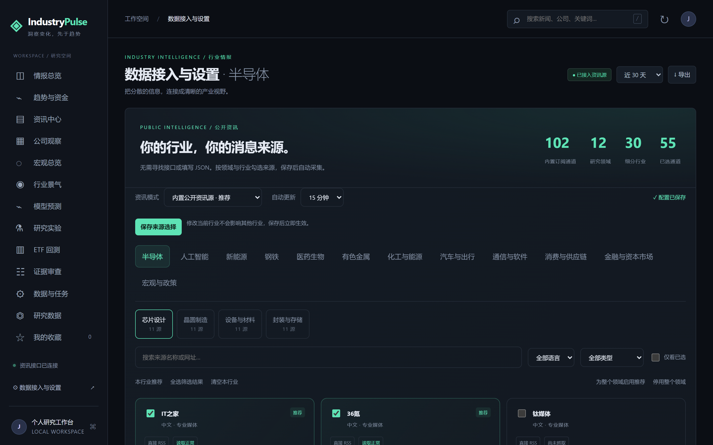

# IndustryPulse

本地优先的行业经济监测、预测与投资研究工作台：从官方公告与公开资讯采集行业数据，
计算景气指标、运行预测模型、回测 ETF 策略——所有数据与计算都在你自己的电脑上完成。

## 界面预览

以下截图来自真实运行：资讯为内置公开源实时采集的内容，未接入行情的字段按设计留空（"—"），不虚构数据。

**情报总览**——领域切换、资金排行与时间窗口资讯统计：



**资讯中心**——真实公开资讯流，按细分行业、来源与类别筛选：



**公司观察**——从资讯中识别的公司与相关动态：



**数据接入与设置**——按领域/行业勾选订阅通道，无需申请 API：



## 功能一览

**行业情报工作台**

- 现代化深色界面，整合领域总览、趋势与资金、资讯、人事与公司动态、搜索与收藏。
- 内置 102 个公开资讯订阅通道，覆盖 12 个领域、30 个细分行业（半导体、人工智能、
  新能源、钢铁、医药生物、有色、化工、汽车、通信、消费、金融、宏观政策）。
  在设置页按行业勾选即可订阅，无需申请任何资讯 API，默认每 15 分钟自动更新。
- 可选配置 OpenAI 兼容模型 API（Base URL + Key），用于新闻 AI 解读与公告信息抽取；
  不配置不影响其他功能，本地统计模型也不依赖它。

**真实数据与研究**

- **行情与宏观（2026-10-23 起）**：12 个行业板块指数与 ETF 真实涨跌、180 日趋势、
  沪深300 基准对比、七大指数报价、行业龙头 A 股行情（现价/市值/PE/PB），
  以及 31 项中国宏观指标（GDP/CPI/PPI/PMI/社融/M2/LPR/Shibor/国债收益率/进出口/用电量等），
  全部来自腾讯/东方财富公开接口与官方统计，界面标注来源与数据期次。
- **官方数据接入**：国家统计局公告自动发现与按月回填、上期所期货日行情、
  FRED/ALFRED 实时版本、海关 HS 版本化数据、AKShare 备用导入，以及手工导入；
  每条观测保留原件归档与 sha256 指纹，可追溯到来源。
- **三种证据模式**（STRICT / RECONSTRUCTED / EXPLORATORY）：支持按任意历史时点
  重建"当时实际可见"的数据，从机制上避免未来函数；严格模式证据不足时宁可返回空，
  不伪造覆盖。
- **八类统计预测模型**（M00–M07，从朴素基线、季节性、AR、Logit、Elastic Net 到
  动态因子、LightGBM、Markov 状态模型）：支持冻结特征与训练截止的半年扩展窗
  滚动实验，含 purge/embargo、共同 OOS、分年评估与 bootstrap 区间。
- **ETF 回测引擎**：次日开盘成交、佣金 + 滑点 + 现金利息、权重与换手约束、
  分红入账、同成本买入持有基准、逐笔事件与已实现盈亏。
- **证据审查**：候选导入、官方公告搜索、原件核验、批准/拒绝留痕，审查后才发布。
- **运维**：数据包导入导出、Parquet/Bronze 备份与 hash 核验恢复、
  每日采集与月末预测的本地定时调度。

## 安装与启动

环境要求：Windows（主要验证平台）· Python 3.13（兼容 `>=3.12,<3.14`）· [uv](https://docs.astral.sh/uv/) ≥0.12

```powershell
uv sync --all-extras
./scripts/start-dashboard.ps1     # 或直接双击 启动IndustryPulse.cmd
```

没有 uv？直接双击启动即可：首次没有可用 Python 时，控制台会让你粘贴路径
（python.exe 或 conda 环境目录），验证后记住，以后启动不再询问。
也可以用 `-PythonPath` 参数、`INDUSTRYPULSE_PYTHON` 环境变量或项目 `.venv`。

启动后自动打开独立应用窗口（不占用普通浏览器），默认地址 http://127.0.0.1:8765 。
启动控制台是总开关：关闭控制台或按 Ctrl+C 会结束界面、服务与全部后台任务；
关闭应用窗口同样退出。数据、设置与调度配置在重启后沿用。

## 上手路径

1. **看资讯**：开箱即用。进入「数据接入与设置」，按领域/行业勾选资讯来源并保存。
2. **接 AI（可选）**：设置页填写 Base URL 与 API Key，测试后保存即为默认模型。
3. **做研究**：宏观总览 → 行业景气 → 模型预测 → 滚动实验 → ETF 回测，
   全程支持选择研究模式、历史时点与冻结快照。
4. **审证据**：证据审查页导入候选、核对原件后发布。
5. **挂调度**：数据与任务页开启每日采集与月末预测（需保持服务运行）。

## 命令行工具

图形界面之外，全部能力均可通过 `industrypulse` CLI 驱动（`uv run industrypulse --help`）：

| 命令 | 用途 |
|---|---|
| `doctor` | 环境自检 |
| `source list / permit` | 数据源清单与许可状态 |
| `init` / `ingest` | 初始化数据库、单源摄取 |
| `backfill` / `backfill-monthly` | 批量回填、按月公告发现与回填 |
| `calendar derive / validate` | 交易日历推导与校验 |
| `compare-modes` | 三种证据模式对照 |
| `etf` / `backtest` | ETF 数据管道与回测 |
| `workbench-run` | 预测/实验/回测/备份等后台作业 |
| `serve` | 启动 API 服务 |

## 数据与隐私

- 本地优先：研究数据存于 `data/g2.duckdb`（DuckDB，单写者），资讯缓存与设置在
  `data/news/`，均不入 Git，可随时备份或删除。
- 除你主动配置的资讯源抓取与模型 API 调用外，系统不向任何服务器发送数据。
- 未配置的授权数据与 API Key 不会被程序假定存在；来源失败时保留上次成功内容并
  显示错误，不静默降级。

## 局限与声明

- **本系统不提供投资建议。** 模型状态保持 NOT_VALIDATED / UNCALIBRATED / NO_EDGE，
  统计模型概率不是投资胜率；在样本不足时系统宁可返回"证据不足"，也不宣称优势。
- ETF 行情来自第三方公开接口（C 级证据），复权口径已交叉验证，但历史主表仍待官方核验。
- 历史文档的"同期原件"证据无法追溯补办，严格模式只能从启用捕获后向前累积。
- 不绕过登录、验证码或付费墙；无真实行情时涨跌、资金流与价格曲线留空，不虚构。

## 文档

| 文档 | 内容 |
|---|---|
| [运行手册](docs/operations.md) | 启动、模型与资讯设置、调度、研究工具、故障处置 |
| [资讯源说明](docs/news-sources.md) | 内置来源覆盖、采集行为与可用性 |
| [工作台 API](docs/dashboard-api.md) | JSON API、字段结构与可选环境变量 |
| [开发任务书](IndustryPulse_开发任务书_V2.0.md) | 完整产品需求规格（IP-SRS-002） |
| [docs/](docs/) | 架构、API、数据源、研究协议、runbook 与历轮交付记录 |

## 开源许可

以 [MIT 许可](LICENSE) 发布。资讯内容版权归各发布方所有，本软件仅作为个人订阅阅读器展示摘要与原文链接。

## 开发

```bash
uv sync --all-extras
uv run ruff check src tests scripts && uv run ruff format --check src tests scripts
uv run mypy src                       # strict
uv run pytest --cov=industrypulse
uv run python scripts/export_contracts.py --check
```

- 共享数据合同冻结于 `src/industrypulse/contracts/`（Pydantic v2），
  生成物在 `contracts/`（勿手改）；变更流程见 [docs/contracts-v1/README.md](docs/contracts-v1/README.md)。
- 开发过程、各阶段验收记录与已知事项见 [STATUS.md](STATUS.md)。
- CI 配置覆盖 Windows/Linux × Python 3.12/3.13；本仓库无远端，云端矩阵未实际执行。
