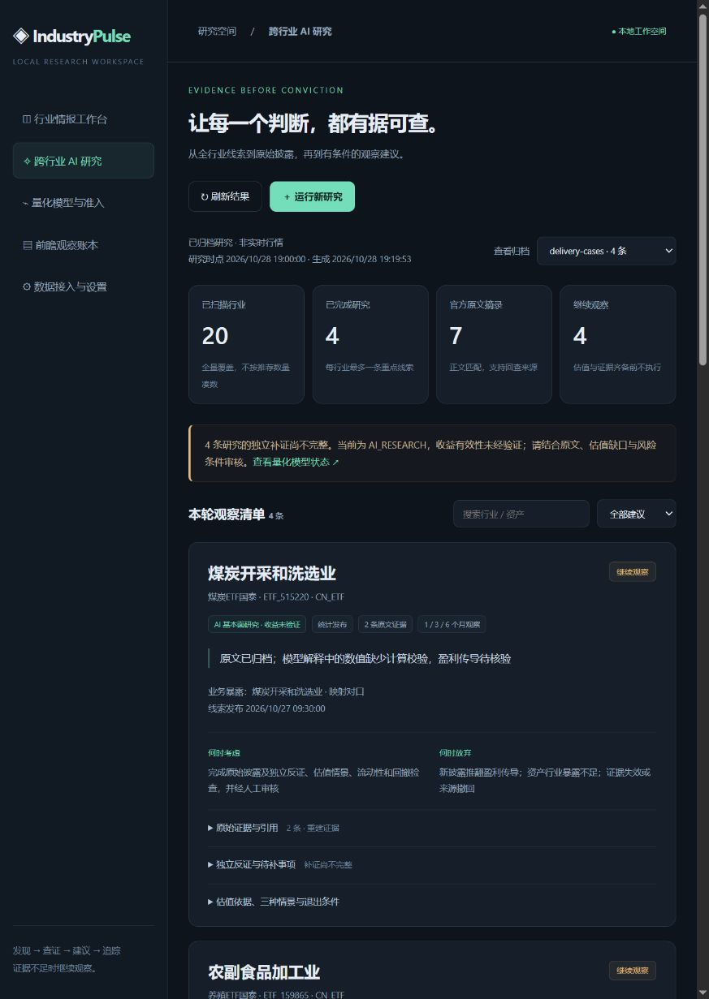

# IndustryPulse

本地优先的行业情报与 AI 投资研究工作台。覆盖20个研究行业，把公开资讯、行业统计、原始披露、资产映射和前瞻观察记录连接起来。支持 Windows、macOS、Linux 的浏览器运行方式；Windows 额外提供独立桌面窗口。



## 快速开始

macOS/Linux 如果没有 `python` 命令，可将创建环境时的 `python` 换成 `python3`。

需要 **Python 3.12 或 3.13**、Git，以及可访问所配置模型和公开数据源的网络。运行前端不需要 Node.js。以下命令均在项目根目录执行；推荐从源码检出后安装，不将未包含配置/静态资源的单独 wheel 当成完整发行包。

```sh
git clone https://github.com/jasonxuan12345/IndustryPulse.git
cd IndustryPulse
python -m venv .venv
```

Windows PowerShell：

```powershell
.\.venv\Scripts\python.exe -m pip install -e .
Copy-Item .env.example .env
# 编辑 .env 填入 API，或启动后在设置页配置模型
.\.venv\Scripts\python.exe scripts/start_dashboard.py
```

macOS / Linux：

```sh
.venv/bin/python -m pip install -e .
cp .env.example .env
# 编辑 .env，或在设置页配置模型
.venv/bin/python scripts/start_dashboard.py
```

打开 [工作台](http://127.0.0.1:8765/) 或 [跨行业 AI 研究](http://127.0.0.1:8765/research)。Ctrl+C 停止服务，已有数据保留。更换端口使用 `--port 8766`。浏览器只是界面，服务进程需持续运行才能执行后台任务。

已安装 [uv](https://docs.astral.sh/uv/) 时也可使用 `uv sync`，然后 `uv run python scripts/start_dashboard.py`。Windows 原有 `启动IndustryPulse.cmd` / `scripts/start-dashboard.ps1` 仍可启动独立窗口；它们不是 macOS/Linux 的入口。

### 配置 API

复制的 `.env` 由跨平台启动脚本加载，已有进程环境变量优先；设置页配置保存到本机 `data/model-provider.json`。未填写环境配置时使用设置页保存的连接。

```dotenv
INDUSTRYPULSE_MODEL_BASE_URL=https://api.deepseek.com/v1
INDUSTRYPULSE_MODEL_API_KEY=替换为自己的密钥
INDUSTRYPULSE_MODEL_NAME=服务商实际提供的模型ID
INDUSTRYPULSE_MODEL_PROTOCOL=chat_completions
```

支持 **OpenAI 兼容 Chat Completions** 和 **Responses** 协议；可配置 DeepSeek、兼容云服务或本地兼容服务的 Base URL、模型和密钥。Responses 服务将协议改为 `responses`。本地免密服务可留空密钥。原生 Anthropic、Azure 特有鉴权等非兼容接口需要适配或兼容网关，不能仅换一个 URL 就假定支持。

AI 自主补证还需要搜索及正文读取接口。默认是 DeepSeek Search/Fetch；当模型也使用同一来源的 DeepSeek 服务时可沿用该服务密钥。其他模型服务必须另配检索密钥：

```dotenv
INDUSTRYPULSE_SEARCH_URL=https://api.deepseek.com/v1/tools/search
INDUSTRYPULSE_FETCH_URL=https://api.deepseek.com/v1/tools/fetch
INDUSTRYPULSE_SEARCH_KEY=检索服务密钥
```

自建检索服务需兼容本文档约定的 JSON 请求/响应；详见 [部署与配置](docs/deployment.md)。密钥不会跨服务来源自动复用，也不会由设置查询接口返回明文。`.env`、本地设置、数据库及运行工件均排除在 Git/Docker 构建上下文之外。

**配置 API 不等于自动拥有全部历史数据。** 首次启动即可浏览公开资讯并配置模型；研究链路可基于已采集新闻运行，缺失统计/行情会明确降级。历史预测、回测与严格 PIT 需要另行导入/采集历史数据；未知数据不补成数字。

## 现在能做什么

- **行业情报**：公开资讯源按领域、细分行业订阅；保留原文链接、发布时间、缓存与失败状态。行情、资金流、商品和宏观接口可用时显示；缺项集中说明原因和处理入口，不保留空图框。
- **跨行业 AI 研究 `/research`**：扫描20行业，每行业最多一条、全局最多5条机会。支持和反对分别检索，读取官方正文，核验逐字摘录、日期与hash。展示资产暴露、估值缺口、三种情景、考虑/放弃/退出条件、1/3/6月观察窗。
- **可追溯输出**：机会队列、证据包、反证审查、投资 memo 和每日 Markdown 简报；前端支持筛选、切换归档、后台运行与下载。断点恢复、失败日志及幂等入账复用原项目机制。
- **量化研究 `/research/quant`**：保留原统计模型、T1/T2/T3目标、样本外验收、ETF回测、分红/费用与风险门槛。未通过验收的预测不标为有效信号。
- **前瞻账本 `/ledger`**：冻结原始判断，跟踪成熟窗口；未来收益与未成熟标签不会回填成已验证结果。
- **本地运维**：数据包导入/导出、备份恢复、来源健康与调度。已知交易日收盘后运行；日历缺失或日期未知时跳过并留痕，需补入日历，不能以工作日代替交易日。

当前 AI 研究是 **AI_RESEARCH / 收益未验证**。估值及资产证据不足时输出 WATCH/REJECT，不制造精确目标价与收益；需要人工审核，无实盘下单功能。

## Docker（可选）

安装 Docker Desktop 或 Docker Engine + Compose，先复制并填写 `.env`：

```sh
docker compose up --build -d
# 停止，保留命名卷中的数据
docker compose down
```

浏览器地址同上。默认仅绑定宿主机127.0.0.1；模型设置、数据和工件保存在命名卷中。容器内不能用 `localhost` 指代宿主机的模型服务；地址、权限和 Linux 网关配置见 [部署说明](docs/deployment.md)。

## 离线样例与验证

[examples/research-mvp](examples/research-mvp/) 随仓库提供四行业公开披露样例、裁剪冻结输入和无凭据工具归档，属于事后重建材料，不是新装环境的实时推荐。

```sh
# 将下面 python 换成当前虚拟环境解释器；脚本禁用网络后验证三次连续运行、幂等和故障注入
python scripts/verify_mvp_delivery.py
```

样例没有收益有效性证明；四条建议均保持 WATCH。历史本机验收和前端记录见 [MVP 验收](acceptance_report.md)、[前端验收](docs/mvp-ui-acceptance.md)。当前跨平台验证与限制见 [发布核验](docs/portability-acceptance.md)。

## 开发与测试

```sh
python -m pip install -e ".[dev,advanced]"
python -m ruff check src tests scripts
python -m ruff format --check src tests scripts
python -m mypy src
python scripts/export_contracts.py --check
python -m pytest --basetemp=artifacts/pytest-local --disable-warnings
node scripts/check_dashboard_states.cjs
```

Node.js 22+ 仅用于前端开发校验。LightGBM、AKShare 是可选项，分别通过 `.[advanced]`、`.[market]` 安装；Linux 的 LightGBM 可能需要系统 OpenMP 运行库；macOS 使用前执行 `brew install libomp`。默认核心安装不依赖它们。

CI 覆盖 Windows / macOS / Ubuntu × Python 3.12 / 3.13，执行静态检查、合同同步、回归和前端状态校验。实际结果以 [GitHub Actions](https://github.com/jasonxuan12345/IndustryPulse/actions) 为准，不将配置了矩阵等同于已经验证所有环境。

## 文档

- [部署与配置](docs/deployment.md)：系统环境、API、容器、首次运行与故障排查。
- [MVP 运行手册](README_MVP.md)：研究命令、预算、证据约束与复现。
- [运维手册](docs/operations.md)：采集、调度、量化研究、备份与停止。
- [界面 API](docs/dashboard-api.md)：前端接口与数据形状。
- [历史开发任务书](IndustryPulse_开发任务书_V2.0.md)：原始需求，不代表所有研究效果已经验收。

本项目以 [MIT](LICENSE) 发布。资讯与披露内容归各发布方所有，研究结论不构成收益承诺。
